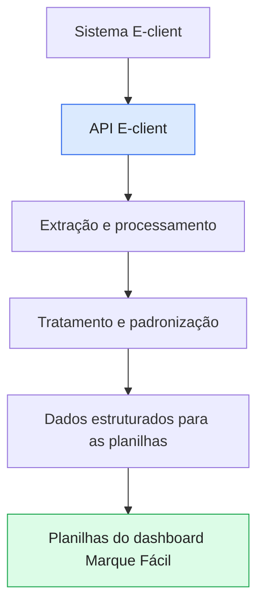
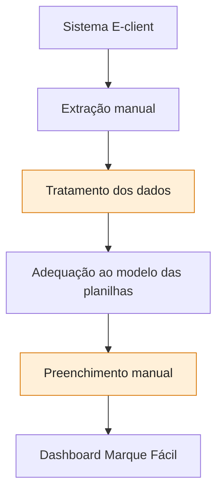

# MARQUE FÁCIL — Integração de Dados via API E-client

## Automatização da extração e preparação dos dados

O projeto [**API — CISBAF-OBSERVATORIO**](https://github.com/CISBAF-OBSERVATORIO/api-hygia) tem como objetivo automatizar etapas de extração, processamento e preparação de dados provenientes do sistema E-client.

A integração permite obter os dados e prepará-los no modelo e na estrutura necessários para alimentar as planilhas utilizadas no dashboard do **Marque Fácil**, reduzindo o trabalho manual e facilitando a atualização das informações.

## Fluxo com a API

**Repositório do projeto:** [github.com/CISBAF-OBSERVATORIO/api-hygia](https://github.com/CISBAF-OBSERVATORIO/api-hygia)

## Processo sem a API

Caso a API não seja utilizada, a atualização deverá ser feita manualmente:

1. Extrair os dados diretamente do sistema E-client.
2. Tratar e organizar as informações.
3. Adequar os dados ao modelo e à estrutura exigidos pelas planilhas.
4. Conferir os valores antes de atualizar os indicadores.

## Benefícios da integração

- **Agilidade:** reduz o tempo gasto na obtenção e preparação dos dados.
- **Padronização:** facilita a adequação das informações ao formato esperado pelas planilhas.
- **Redução de tarefas manuais:** diminui a necessidade de copiar, tratar e inserir dados manualmente.
- **Consistência:** reduz o risco de erros operacionais durante a preparação das informações.

**Em resumo:** a API E-client automatiza etapas do processo de obtenção e preparação dos dados para o dashboard Marque Fácil. Sem essa integração, é necessário extrair os dados do sistema, tratá-los e organizá-los manualmente antes de preencher as planilhas.
